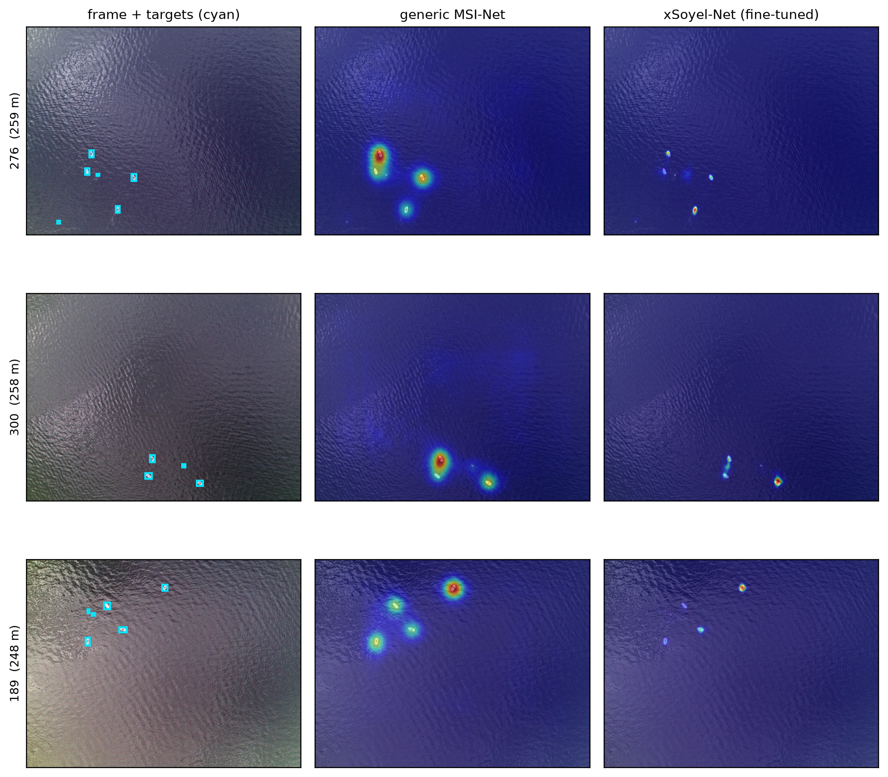

# Maritime SGTile

Code and results for:

> Hamit Soyel. **Altitude- and Saliency-Guided Adaptive Tiling for Efficient Small-Object
> Detection in Maritime Search and Rescue.** IEEE Geoscience and Remote Sensing Letters
> (under review).

## The result in one paragraph

UAV search and rescue over open water needs to detect very small objects in high-resolution
frames that are mostly empty sea. The standard remedy, SAHI, tiles every frame uniformly
and runs the detector on all tiles, which is wasteful and amplifies sea-clutter false
positives. We cast inference-time tiling as one **computation-allocation** problem with two
degrees of freedom: tile **scale** (from the UAV's altitude telemetry) and tile **location**
(from a target-aware saliency prior, **xSoyel-Net**, our fine-tuned MSI-Net). On
SeaDronesSee Object Detection v2 the full system cuts processed tiles by **84%**
(29.0 to 4.7 per frame) and false positives by **22%** at matched recall with neutral mAP, a
**3.7x** wall-clock speed-up and **6.1x** fewer detector FLOPs. The prior is validated as a
target proxy directly (tile-level ROC-AUC **0.976** vs 0.876 for a generic prior; Spearman
**0.869** with detector confidence; **98.8%** of targets retained at half the tiles). A
cross-architecture study over a one-stage CNN (YOLO11s), a transformer (RT-DETR), and a
two-stage detector (Faster R-CNN) shows the location term transfers universally while the
scale term helps scale-flexible detectors and should be omitted for two-stage models.



## Figures

- `figures/qual_saliency.png` generic MSI-Net vs fine-tuned xSoyel-Net (paper Fig. 3).
- `figures/qual_tiles.png` kept vs dropped tiles under saliency selection (0 missed targets,
  98.8% val coverage at 51% fewer tiles).
- `figures/qual_gating.png` why gating is dropped: a valid faint target (confidence 0.14) is
  pushed below the operating threshold to 0.11 by a generic prior.
- `figures/flops_pareto.png` compute-precision Pareto front.

## Reproduction

1. **Get SeaDronesSee Object Detection v2** (not redistributed here):
   https://github.com/Ben93kie/SeaDronesSee . Convert with `data/convert_seadronessee.py`
   and slice tiles with `data/slice_dataset.py`; generate saliency maps with
   `data/gen_saliency.py`.
2. `pip install -r requirements.txt`
3. Train the detector on tiles and xSoyel-Net on the train split
   (`train/train_tiled.py`, `saliency/finetune.py`); saliency targets via
   `saliency/make_target_maps.py`.
4. Evaluate baseline vs adaptive:

```bash
python eval/run_eval.py --backend yolo --weights <det.pt> \
    --val-coco-json <instances_val.json> --images-dir <val/images> \
    --saliency-dir <val/saliency> --use-altitude --use-saliency-select \
    --gate-alpha 0 --keep-thr 0.05 --out results/S1.json
python eval/make_qual_figs.py        # qualitative figures
python eval/latency_bench.py         # wall-clock timing
```

Pre-computed result JSONs for every number in the paper are in `results/`
(`cross_arch_final.json`, `flops_pareto.json`, `saliency_target_auc.json`,
`saliency_conf_corr.json`, `altitude_slice.json`, `latency.json`).

## Cross-architecture study (GPU)

The second-detector experiment trains and evaluates each detector on SageMaker:
`train/train_tiled.py` (YOLO / RT-DETR, ultralytics) and `train/train_frcnn.py`
(torchvision Faster R-CNN, YOLO-format tiles converted to xyxy). `sm_eval.py` +
`launch_eval.py` run baseline vs S1 for a given backend on GPU (`--backend`, `--alt`,
`--conf`). **Note on Faster R-CNN:** its output coordinate and score calibration differ from
the one-stage detectors; the altitude-resizing term interacts with its fixed RPN anchor
scales, so two-stage detectors should use selection without altitude sizing (see the paper).

## Repository layout

```
tiling/        adaptive tiling, geometry (Eq. tile-size), SAHI baseline, detector backends
saliency/      xSoyel-Net (MSI-Net port), target-map rendering, fine-tuning
eval/          run_eval (baseline + adaptive), evaluate, figures, latency, altitude slices
train/         detector training (YOLO/RT-DETR ultralytics; Faster R-CNN torchvision)
data/          SeaDronesSee conversion, tiling, saliency generation
sm_eval.py, launch_*.py   SageMaker training and eval harness
figures/       paper figures
results/        pre-computed JSONs backing every number
```

## License / data

- Code: MIT (see `LICENSE`).
- **SeaDronesSee images and labels are NOT redistributed**: obtain them from the dataset's
  release and observe its terms. This repo contains only code, derived aggregate results,
  and rendered figures.
- MSI-Net base weights come from the original authors' release; xSoyel-Net is fine-tuned from
  them on the SeaDronesSee training split.
